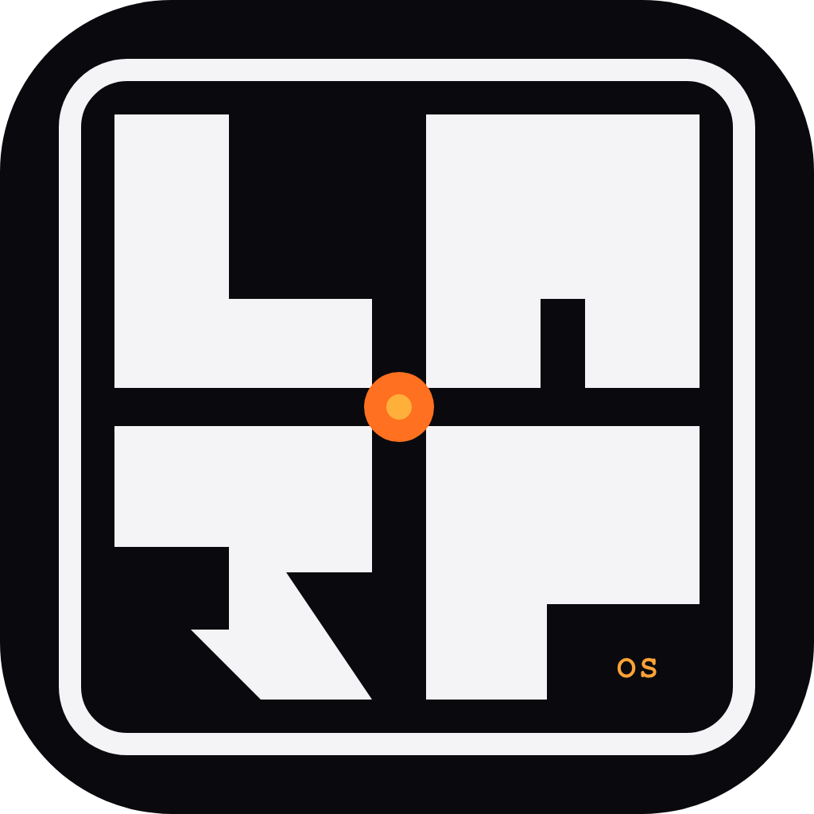
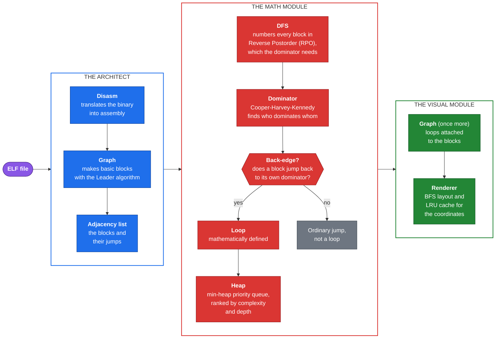
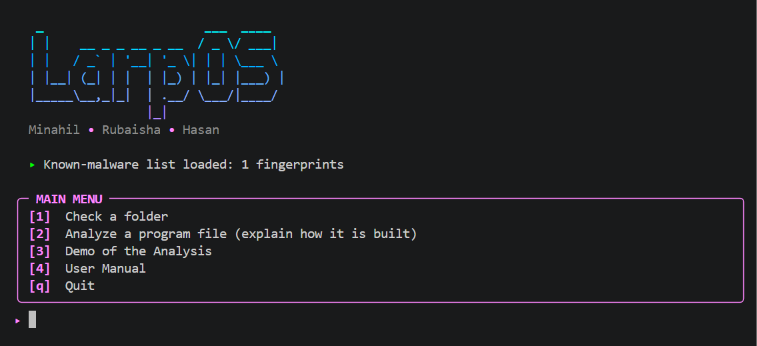
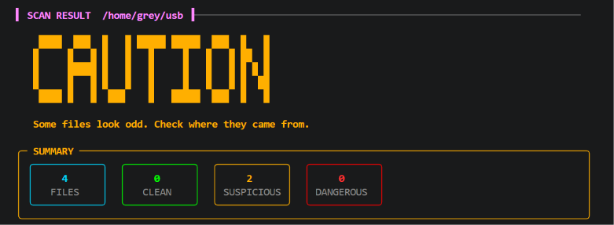
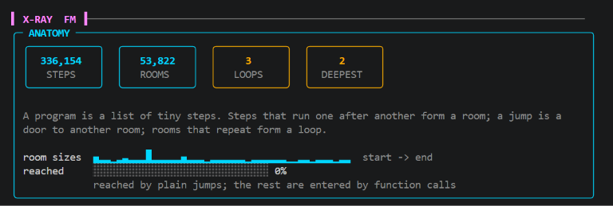
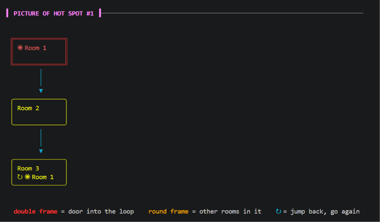

<div align="center">
<p align="center">
  
</p>
  
#  LARP OS
**A Minimalist, Offline Reverse-Engineering Operating System**

[](#-license--credits)
[]()
[]()


</div>

---

## What is LARP OS?
LARP OS is not a normal application. It is a **custom, bootable Linux distribution** built entirely from source using Buildroot. 

It boots in seconds directly into a custom C++ reverse-engineering engine. It strips away the bloat of modern operating systems (no web browsers, no window managers, no package managers) to do exactly one thing: **safely analyze Linux ELF binaries without ever executing them.**

Because it operates completely offline and statically reads raw bytes, it is perfectly safe to analyze malware and viruses without worrying about them escaping. LARP OS will scan them, map them, and visualize the loops without the host machine ever being at risk.

---

## The Data Structures & Algorithms (DSA) Behind It
LARP OS was built for a Data Structures & Algorithms course. Every single phase of the pipeline is powered by a custom-implemented DSA structure.

| Module | File | Data Structure / Algorithm | Why it was used |
| :--- | :--- | :--- | :--- |
| **Architect** | `graph.cpp` | **Graph (Adjacency List)** | To model the Control Flow Graph (CFG) where nodes are Basic Blocks and edges are jumps. |
| **Architect** | `graph.cpp` | **Hashmap (Open Addressing)** | To store the CFG for \(O(1)\) instant lookup of blocks by their memory address. |
| **Math** | `Dfs.cpp` | **DFS (Depth-First Search)** | To traverse the graph and generate Reverse Postorder numbering. |
| **Math** | `Dominator.cpp` | **Dominator Tree** | Uses Cooper's Algorithm to find the "boss" nodes, proving where loops exist (Back-Edges). |
| **Math** | `Heap.cpp` | **Binary Heap (Min-Heap)** | A Priority Queue to rank loops by complexity and push the most dangerous ones to the top. |
| **Visual**| `Renderer.cpp` | **BFS (Breadth-First Search)** | To calculate the X/Y grid layout so blocks are drawn side-by-side without overlapping. |
| **Visual**| `LRU.h` | **LRU Cache (DLL + Hashmap)** | To cache screen coordinates so the renderer doesn't recalculate where a block goes. |
| **Scanner** | `Scanner.h` | **SHA-256 & Trees** | Cryptographic hashing for known-bad files, and DFS for walking the USB directory tree. |

---

## How It Works (The Pipeline)

### The Workflow
Every file follows this path. Colours match the modules: **blue** is the Architect, **red** is the Math Module, **green** is the Visual Module. BUILDROOT INTEGRATION NOT INCLUDED IN THE CHART.



**Key ideas behind the diagram**

| Term | What it means |
| :--- | :--- |
| **Leader algorithm** | Finds the first instruction of every basic block, so the flat assembly can be cut into blocks. |
| **RPO (Reverse Postorder)** | The order in which DFS finishes the blocks, reversed. The dominator step needs it. |
| **Dominance** | Block A dominates block B when every path to B passes through A first. In nested loops, the outer loop A dominates the inner loop B. |
| **Back-edge** | A jump that returns to the block that dominates it. Jumps and function calls can *look* like back-edges, but only count if control returns to that dominating block. *Analogy: a recursive function without a base case.* |
| **Loop** | If a block has an edge pointing to its own dominator, it is a mathematically defined loop. The back-edge test finds exactly these. |
| **Heap** | Takes every loop from the dominator step and keeps them in a min-heap (priority queue), ranked by complexity and depth, so the most complex loop comes out first. |

### 1. The Virus Scanner (Triage)
Before analyzing a file, the Scanner checks it without executing it. It looks for disguised files (a PDF that is secretly an ELF), dangerous strings (`bash -i`, `/etc/shadow`), high entropy (packed/encrypted malware), and SHA-256 hash matches against known viruses.

### 2. The X-Ray analysis (CFG)
It uses `libelf` and the **Capstone Engine** to translate raw machine code into assembly. It chops the code into Basic Blocks and builds a map. It then uses a **Dominator Tree** to find loops. 

### 3. The Visualization (TUI Renderer)
Using a custom LRU Cache and BFS layout, it draws the graph directly to the terminal. 
*   **Red Double Frame:** The Loop Header (the door into the loop).
*   **Yellow Round Frame:** The blocks inside the loop.
*   **Circle Arrow (↻):** A back-edge. The exact jump instruction that goes backward.

---

## Gallery

<div align="center">
  
  <br>
  <i>LARP OS boot and the main menu.</i>
</div>
<br>
<div align="center">
  
  <br>
  <i>The Scanner searches the mentioned folder for malicious files.</i>
</div>
<div align="center">
  
  <br>
  <i>Detailed analysis of selected ELF files.</i>
</div>
<div align="center">
  
  <br>
  <i>A control flow graph of the most suspicious/complex/deep loop in the selected file </i>
</div>

---

## How to Use LARP OS (For Friends & Testers)

You'll need the final compressed OS image.

1. Download the `iso.zip` file directly from the release tab.
2. Extract the zip file. You will find two files: `bzImage` (the kernel) and `rootfs.ext2` (the OS).
3. Install QEMU on your computer:
   * **Windows:** Download from [qemu.org](https://www.qemu.org/download/#windows).
   * **Mac:** Run `brew install qemu`.
   * **Linux/WSL:** Run `sudo apt install qemu-system-x86`.
4. Open your terminal/command prompt in the folder where you extracted the files.
5. Run this exact command to boot LARP OS:

```bash
qemu-system-x86_64 -m 1024 -kernel bzImage -hda rootfs.ext2 -append "root=/dev/sda console=ttyS0" -nographic
```
##  License & Credits

### Black Hole Animation (ASCII Art)
The dynamic black hole animation/GIF used in this README was created by **JIN2 (@JIN2-ASCII)**. 

**License Terms:**
> Black hole
> Copyright (c) 2026 JIN2 (@jin_22ee on Instagram). All rights reserved.

*You can view the original repository here: [JIN2-ASCII](https://github.com/JIN2-ASCII/-JIN2-ASCII)*

### LARP OS (The Operating System)
The custom C++ engine, OS build scripts, and documentation for LARP OS are open-source for educational purposes. 

**Authors:**
*   Minahil (Architecture and os build)
*   Rubaisha (Visuals and documentation)
*   Hasan (Math and algorithms)

---
*This project is for educational purposes only. Do not use LARP OS to execute malware on production machines.*
